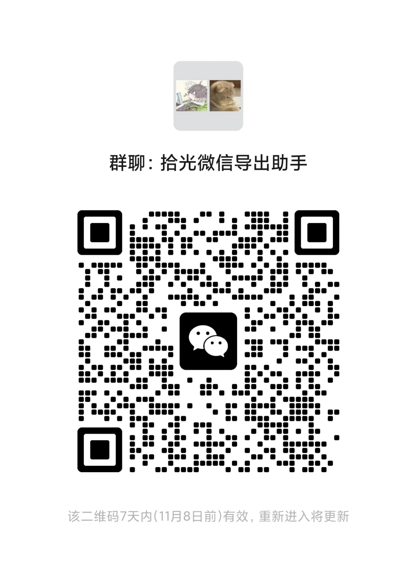

# 微信群讨论

群聊名称：**拾光微信导出助手**。

欢迎讨论功能建议、界面体验、本地聊天归档需求、文件格式以及隐私和技术边界。目前 GitHub 仅保留项目展示与讨论资料，不公开应用源码或安装包。加入群聊不代表获得软件领取资格、平台许可或法律合规保证。

  

[查看二维码原图](assets/wechat-group.jpg)

## 二维码有效期

- 本次更新日期：**2026-11-01**。
- 原图标注：**7天内（11月8日前）有效，重新进入将更新**。
- 实际有效性以微信显示为准。本页不会自动刷新二维码，过期或群满时请留意维护者后续更新。

## 交流边界

请勿在群内或公开 Issues 发布真实聊天内容、联系人、账号凭据、数据库、密钥、内存转储、未脱敏日志或私密附件。讨论问题时先提供版本、操作步骤和脱敏错误提示。

群内交流不代表取得微信官方授权，也不能替代对具体数据处理、软件使用或分发行为的授权和法律评估。请遵守群规则与相关法律法规，详细边界见 [NOTICE.md](NOTICE.md) 和 [PRIVACY.md](PRIVACY.md)。
