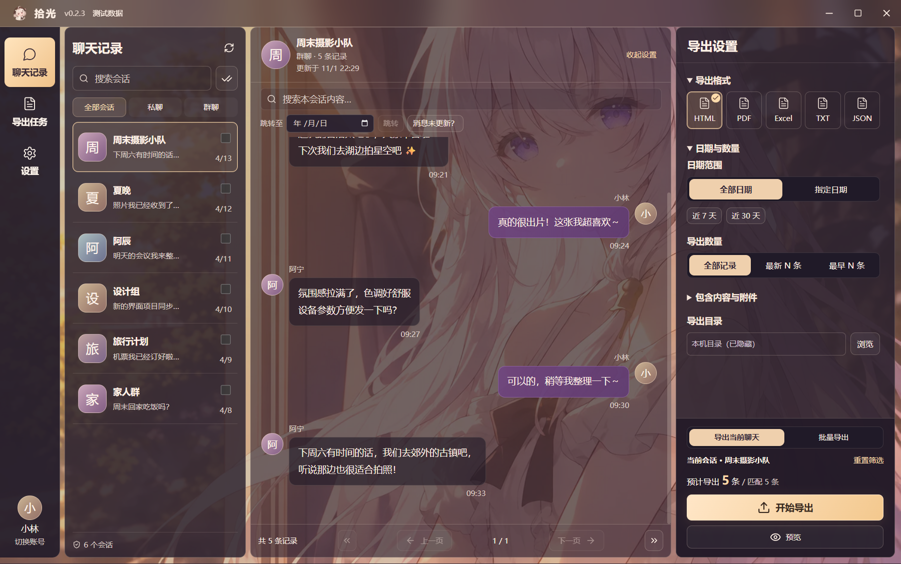
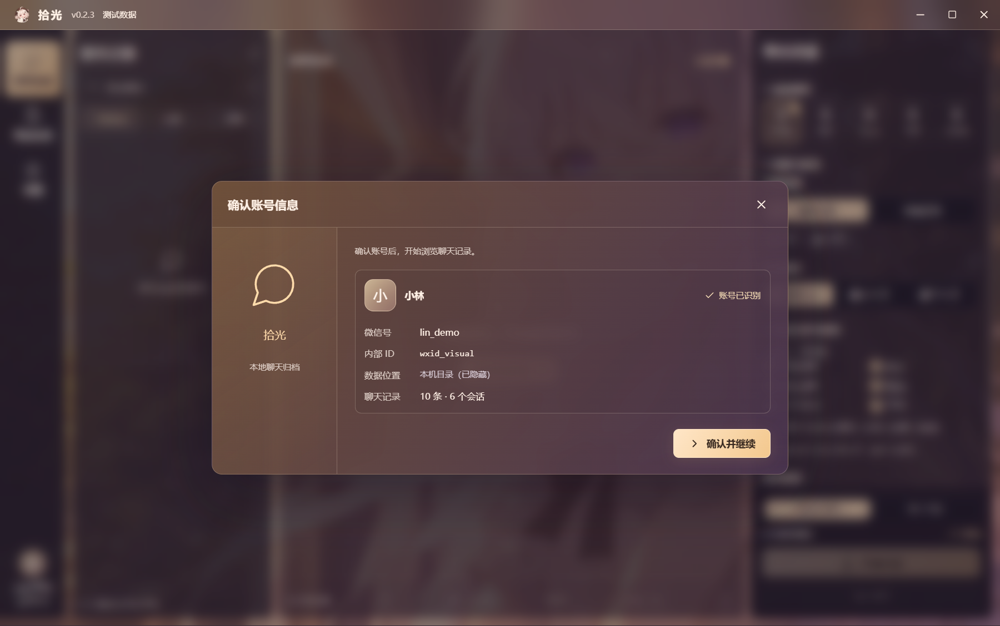
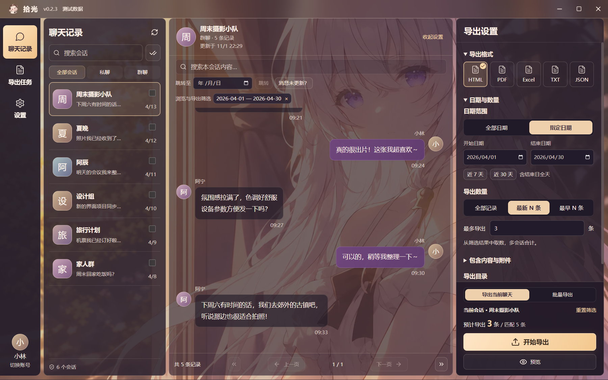

  
  <h1>拾光 · 微信聊天归档</h1>
  
一个有玻璃质感的 Windows 微信聊天浏览与导出工具。

  
本机处理 · 无需会员 · 日期与数量筛选 · 文件 / 图片 / 视频附件

  

    <a href="https://github.com/GGBond2424648901/shiguang-wechat-export/releases/latest">下载安装版</a> ·
    <a href="USAGE.md">使用说明</a> ·
    <a href="https://github.com/GGBond2424648901/shiguang-wechat-export/issues">问题反馈</a>
  

> 截图来自 v0.2.3 实际运行界面。账号、联系人和聊天内容均为虚构演示数据，本机目录已隐藏。

## 可以做什么

- **浏览私聊和群聊**：识别当前微信使用的本机账号，读取后核对昵称和微信号，再进入聊天记录。
- **从最新消息开始**：默认显示最近 200 条，可翻页查看更早记录；搜索关键词、定位日期、查看上下文。
- **按范围导出**：指定日期、近 7 天 / 30 天，或选择全部记录、最新 N 条、最早 N 条；支持当前聊天和多会话批量导出。
- **五种格式**：HTML、PDF、Excel、TXT、JSON，导出前可预览范围和预计数量。
- **附带本机附件**：普通文件、可解析图片，以及通过本地媒体索引、大小和 MD5 校验的 MP4 视频。缺失或不兼容的项目会列出原因。
- **保留本地归档与任务**：查看最近 100 次导出、打开导出位置、再次载入导出设置。
- **调整阅读体验**：字号、界面深浅、舒适 / 紧凑密度和低干扰阅读模式。

## 下载与开始使用

前往 **[最新 Release](https://github.com/GGBond2424648901/shiguang-wechat-export/releases/latest)**，下载安装版 EXE。安装包自带运行环境，不需要另装 Python 或 Node.js。

1. 在这台电脑登录微信。若最新消息未同步，建议退出微信账号并重新登录，等待同步完成。
2. 打开拾光，选择检测到的当前账号，点击 **读取这个账号**。
3. 核对读取后的昵称、微信号和会话数量，点击 **确认并继续**。
4. 选择聊天，设置日期、数量与格式；需要附件时勾选 **附带本机可用附件**，再开始导出。

系统：Windows x64；目前在 Windows 11、微信 **4.1.7.59** 上验证，其他微信版本尚未完整验证。

## 界面预览

### 读取后确认账号资料

昵称、微信号和微信内部 ID 分开显示。首次检测尚未读取资料时会明确提示；使用上次资料时也会标明来源。

### 指定日期与导出数量

先按日期、关键词和类型筛选，再选最新 / 最早 N 条；多会话的数量限制按合计条数计算。

## 使用前了解

- 拾光读取的是**已经保存到本机的数据**。重新登录并不保证手机中的全部记录已经同步；发现消息未更新时，可查看界面中的“消息未更新？”并刷新记录。
- **附件不是全部可提取。** 普通文件、部分明文 / 旧版 XOR 图片和可校验 MP4 已支持；V1/V2 加密聊天图片、语音提取及转文字尚不支持。
- 使用旧归档导出视频时，如果提示缺少视频索引，请重新读取账号或刷新记录。导出文档与同名 `_media` 文件夹应一起保存、移动。
- 安装器未做数字签名。此前安装测试出现过原生进程异常退出，原因尚未定位；遇到安装问题可在 Issues 反馈系统版本和错误信息。

更多细节见 **[使用说明与常见问题](USAGE.md)**。

## 关于这个仓库

本仓库仅用于软件介绍、截图、版本发布和问题反馈，**不公开应用源码**。安装包通过 GitHub Releases 提供，代码文件、聊天数据库、账号缓存和开发资料不会提交到本仓库。

第三方组件保留各自许可；相关说明见 [THIRD_PARTY_NOTICES.md](THIRD_PARTY_NOTICES.md)。角色图与界面插画的展示不构成对素材单独再授权。本工具与微信官方无隶属关系。
